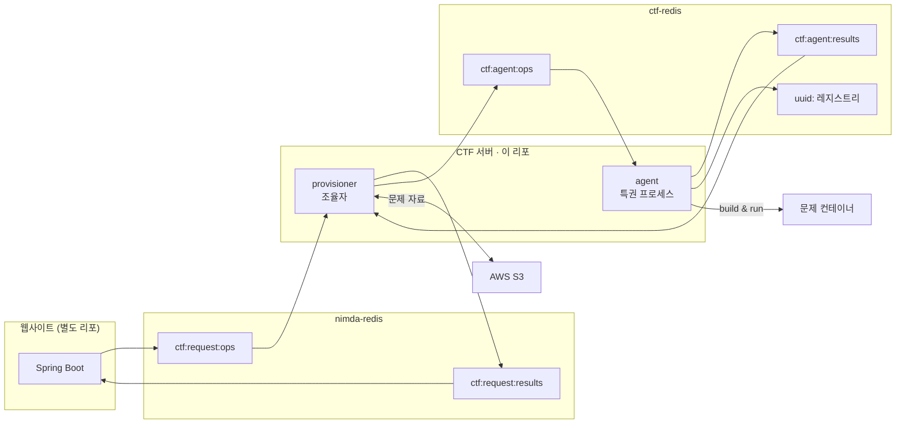

# Nimda CTF Server


## 프로젝트 소개

nimda.kr에서 쓰는 **CTF 문제 환경 서버**입니다. 참가자가 문제를 풀 수 있도록
문제 컨테이너를 띄우고, 접속 주소를 돌려주고, 시간이 지나면 회수합니다.

문제는 두 종류로 나뉩니다.

* **파일만 있으면 되는 문제** (리버싱, 포렌식 등) — S3 presigned URL을 만들어 돌려줍니다.
* **접속할 서버가 필요한 문제** (웹, 시스템 해킹) — 참가자마다 컨테이너를 하나씩 띄웁니다.

원래는 알고리즘 채점 서버였고, 제출한 코드를 isolate로 실행해 정답을 매겼습니다.
CTF로 방향을 바꾸면서 실행·채점 부분을 걷어냈습니다. 플래그 비교는 문자열 하나 맞추는 일이라
웹 서버가 직접 처리합니다. 자세한 배경은
[ADR-0007](<./docs/adr/[ADR-0007] 알고리즘 채점 서버에서 CTF 문제 서버로의 전환.md>)에 있습니다.

---

## 시스템 아키텍처



두 개의 redis를 쓰고, 두 망이 조율자에서만 만납니다. 웹과 주고받는 통(`nimda-redis`)과
CTF 내부 통(`ctf-redis`)을 나눈 이유는
[ADR-0012](<./docs/adr/[ADR-0012] ctf 서버 컨테이너 간 통신 방식 확정.md>)에 있습니다.

## 동작 흐름

웹이 보내는 요청은 uuid 하나로 식별됩니다.
CTF 서버는 요청한 사람이 누구인지 알 필요가 없기 때문에 요청 메시지에 userId는 존재하지 않습니다.

조율자가 문제 카테고리를 보고 할 일을 가릅니다.

| 카테고리 | 작업 | 하는 일 |
| --- | --- | --- |
| `WEB`, `PWN` | `CREATE_INSTANCE` | S3에서 문제 자료를 받아 풀고, 에이전트에게 빌드 경로를 넘긴다 |
| 그 외 | `GET_PRESIGNED_URL` | S3 presigned URL만 만들어 웹으로 돌려준다 |

인스턴스가 필요한 경우의 전체 경로입니다.

```
웹 → ctf:request:ops → 조율자 → (S3 다운로드 · 압축 해제)
                          ↓
                    ctf:agent:ops → 에이전트 → 이미지 빌드 → 컨테이너 실행
                          ↓                         ↓
                    ctf:agent:results          uuid: 레지스트리 기록
                          ↓
                      조율자 → ctf:request:results → 웹
```

같은 uuid가 재전달되면 에이전트가 레지스트리를 보고 **이미 만든 컨테이너를 재사용**합니다.
스트림이 at-least-once라 같은 메시지가 두 번 올 수 있기 때문입니다.

## 구성 요소

| 모듈 | 역할 |
| --- | --- |
| `protocol/` | 웹 ↔ CTF 메시지 계약. 요청/응답 구조와 스트림 직렬화. 두 리포가 공유하는 유일한 규격 |
| `provisioner/` | 조율자. 웹 요청을 받아 작업을 가르고, S3를 다루고, 에이전트에게 넘긴다. 권한이 작다 |
| `agent/` | 특권 프로세스. docker.sock에 붙어 이미지를 빌드하고 컨테이너를 띄운다 |

`go.work`로 묶인 멀티 모듈입니다. 각 모듈의 `internal/`은 모듈 밖에서 import되지 않습니다.

**조율자와 에이전트를 나눈 이유**는 권한입니다. 도커 소켓에 닿는 프로세스는 호스트 root와
같은 권한을 가집니다. 
그래서 S3·네트워크·웹 요청을 다루는 조율자와 소켓을 쥐는 에이전트를 분리해
보안의 경중과 자원 소모가 많은 작업으로 나누었습니다.

([ADR-0009](<./docs/adr/[ADR-0009] 조율자·에이전트 배포 구조 — 컨테이너 분리 대신 프로세스 관리.md>)).

## 문제 컨테이너 조임

| 항목 | 값 | 환경변수 |
| --- | --- | --- |
| 리눅스 capability | 전부 제거 (`CapDrop: ALL`) | — |
| 권한 상승 | 차단 (`no-new-privileges`) | — |
| 메모리 | 256m | `CTF_INSTANCE_MEMORY` |
| 프로세스 수 | 256 | `CTF_INSTANCE_PIDS` |
| 런타임 | 기본값 / 운영은 gVisor | `CTF_CONTAINER_RUNTIME=runsc` |
| 포트 | 호스트 루프백에만 바인딩 | — |

## 실행

```bash
docker compose up -d --build
```

`ctf-redis`, `provisioner`, `agent`가 뜹니다. 조율자는 웹 쪽 `nimda-redis`에도 붙으므로
`nimda-network`가 먼저 있어야 합니다.

에이전트는 `/var/run/docker.sock`을 마운트하고, 조율자와 `ctf-build` 볼륨을 공유합니다.
조율자가 S3에서 받아 푼 문제 자료를 에이전트가 같은 경로에서 읽어 빌드합니다.

```bash
# 테스트
go test ./...
```

## 로그·메트릭

CTF 서버의 컨테이너 로그와 호스트·컨테이너·ctf-redis 메트릭을 같은 EC2 안의 Loki·Prometheus·Grafana로 모은다.
수집은 Grafana Alloy가 하고, 데이터는 별도 EBS 볼륨에 둬서 EC2를 꺼도 남는다(180일 보관).
설정은 [`deploy/alloy/`](./deploy/alloy)와 [`deploy/monitoring/`](./deploy/monitoring)에 있다.
배경은 [ADR-0024](<./docs/adr/[ADR-0024] 로그·메트릭 수집 — CTF EC2 안의 Loki·Prometheus·Grafana, 데이터는 별도 EBS 볼륨.md>),
서버 준비 절차는 [RB-0004](<./docs/runbook/[RB-0004] 모니터링 서버 구성.md>)에 있다.

```bash
# 로컬에서 시험
docker compose --profile monitoring up -d
# Grafana: http://localhost:3000 (admin / admin)
# 서버: ssh -L 3000:127.0.0.1:3000 <user>@<EC2> 후 http://localhost:3000
```

## 설계 기록

결정은 전부 [`docs/adr/`](./docs/adr)에 있습니다. 왜 그렇게 했는지, 무엇을 포기했는지가
같이 적혀 있습니다.

읽는 순서를 추천하면 이렇습니다.

* [ADR-0007](<./docs/adr/[ADR-0007] 알고리즘 채점 서버에서 CTF 문제 서버로의 전환.md>) — 무엇을 만드는 서버인가
* [ADR-0009](<./docs/adr/[ADR-0009] 조율자·에이전트 배포 구조 — 컨테이너 분리 대신 프로세스 관리.md>) — 왜 프로세스를 둘로 나눴나
* [ADR-0012](<./docs/adr/[ADR-0012] ctf 서버 컨테이너 간 통신 방식 확정.md>) — 왜 redis가 둘인가
* [ADR-0014](<./docs/adr/[ADR-0014] 인스턴스 수명(TTL) 정책 — 선언 대신 집행.md>) — 인스턴스는 언제 죽나
* [ADR-0016](<./docs/adr/[ADR-0016] 인스턴스 접근 인가 — 게이트웨이는 판정하지 않는다.md>) · [ADR-0018](<./docs/adr/[ADR-0018] 인증 인가 위치 확정.md>) — 누가 어떤 근거로 접근을 허락하나
* [ADR-0017](<./docs/adr/[ADR-0017] 문제 컨테이너 격리 경계 — 도메인·네트워크·내부 API.md>) — 적대적인 컨테이너와의 경계

그 외 문서는 이렇게 나뉩니다.

| 디렉터리 | 내용 |
| --- | --- |
| [`docs/adr/`](./docs/adr) | 아키텍처 결정 기록 |
| [`docs/features/`](./docs/features) | 기능별 동작 명세 |
| [`docs/runbook/`](./docs/runbook) | 운영 절차 |
| [`docs/patch-note/`](./docs/patch-note) | 변경 이력 |

협업 방법은 [CONTRIBUTING.md](./CONTRIBUTING.md)에 있습니다.