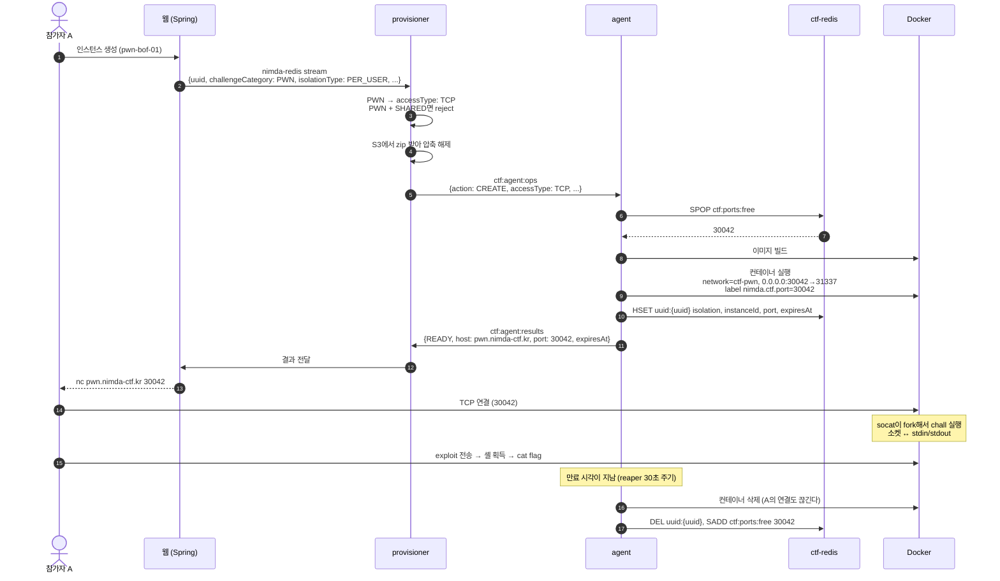

# [Feature-02] pwn 인스턴스

* **최초 작성일:** 2026-10-23
* **최종 수정일:** 2026-10-23
* **작성자:** 이도현
* **상태:** 기획 (아직 구현 안 함). 설계 근거는 ADR-0020.

---

## 1. 개요 (Overview)

pwn 문제를 참가자마다 컨테이너 하나씩 띄우고, 참가자가 자기 터미널에서 `nc host port`로 붙게 한다.

web 문제와 다른 점은 접속 경로 하나다.
web은 웹 프록시를 거쳐 서브도메인으로 붙고, pwn은 포트 풀에서 받은 포트로 바로 붙는다.
컨테이너 생성, PER_USER registry, TTL은 web과 같은 코드를 쓴다.

### pwn을 처음 보는 사람을 위한 한 줄 요약

서버에서 도는 프로그램의 버그(버퍼 오버플로 등)를 이용해서, 그 서버의 셸을 따고 `flag` 파일을 읽는 문제다.
셸을 따는 게 정답이라서 참가자마다 컨테이너가 따로 있어야 한다.

---

## 2. 사용자 요구사항 (Requirements)

### 참가자

1. 참가자는 문제 페이지에서 바이너리와 libc를 받을 수 있어야 한다. (T1 첨부파일 배포를 그대로 쓴다)
2. 참가자는 "인스턴스 생성"을 누르면 `nc host port` 형태의 접속 주소를 받아야 한다.
3. 참가자는 pwntools 같은 자기 도구로 그 주소에 바로 붙을 수 있어야 한다. 토큰이나 추가 절차는 없다.
4. 참가자가 exploit에 실패해서 프로그램이 죽어도, 다시 접속하면 새 프로세스가 떠야 한다.
5. 참가자는 인스턴스 만료 시각을 볼 수 있어야 한다.

### 시스템

1. pwn 인스턴스는 반드시 PER_USER로 뜬다. SHARED 요청은 reject한다.
2. 포트는 `30000-30199` 안에서만 나간다. 이 범위 밖의 포트는 밖에 열지 않는다.
3. 풀이 비면 생성 요청은 `FAILED`로 끝난다. 조용히 포트를 겹쳐 쓰지 않는다.
4. TTL이 지나면 컨테이너를 지우고 포트를 풀에 돌려준다. 붙어 있던 연결도 같이 끊긴다.
5. pwn 컨테이너는 인터넷으로 새 연결을 맺을 수 없다. (reverse shell 차단)
6. pwn 컨테이너끼리 내부망으로 통신할 수 없다.
7. agent가 재시작해도 이미 쓰고 있는 포트를 다시 나눠주지 않는다.

---

## 3. 시나리오

### 시나리오 1. 출제자가 pwn 문제를 등록한다

출제자가 간단한 버퍼 오버플로 문제 `pwn-bof-01`을 만든다고 가정하자.

**1) 문제 프로그램을 만든다**

```c
// chall.c
#include <stdio.h>
#include <stdlib.h>
#include <unistd.h>

void win() { system("/bin/sh"); }   // 여기로 점프하면 셸이 열린다

int main() {
    char buf[32];
    setvbuf(stdout, NULL, _IONBF, 0); // 출력 버퍼링을 끈다. 안 끄면 소켓으로 출력이 늦게 나간다
    puts("name?");
    read(0, buf, 0x100);              // 32바이트 버퍼에 256바이트를 읽는다 → 오버플로
    puts("bye");
    return 0;
}
```

```
gcc -fno-stack-protector -no-pie -o chall chall.c
```

`-fno-stack-protector`, `-no-pie`는 보호 기법을 꺼서 문제를 쉽게 만드는 옵션이다.
문제 난이도에 따라 출제자가 정한다.

**2) Dockerfile 작성**

```dockerfile
FROM ubuntu:22.04
RUN apt-get update && apt-get install -y socat && rm -rf /var/lib/apt/lists/*
RUN useradd -m ctf

# 문제 파일은 root 소유로 둔다. ctf 사용자가 셸을 따도 지우거나 고칠 수 없다.
COPY chall /chall/chall
COPY flag  /chall/flag
COPY entrypoint.sh /entrypoint.sh
RUN chmod 755 /chall /chall/chall /entrypoint.sh && chmod 444 /chall/flag

# CapDrop: ALL이라 컨테이너 안에서 사용자를 바꿀 수 없다. 처음부터 ctf로 돈다.
USER ctf
WORKDIR /home/ctf
EXPOSE 31337
ENTRYPOINT ["/entrypoint.sh"]
```

```sh
#!/bin/sh
# entrypoint.sh
# DYNAMIC이면 agent가 env FLAG로 넣어준다. 파일로 옮기고 env에서 지운다.
if [ -n "$FLAG" ]; then
    echo "$FLAG" > /home/ctf/flag
fi
unset FLAG

# 연결마다 chall을 새로 실행한다(fork). 한 번 죽어도 다음 연결은 새 프로세스를 받는다.
exec socat TCP-LISTEN:31337,reuseaddr,fork EXEC:/chall/chall,stderr
```

STATIC이면 `/chall/flag`를 읽게 하고, DYNAMIC이면 `/home/ctf/flag`를 읽게 문제 설명에 적는다.

**3) 압축해서 등록한다**

`Dockerfile`, `chall`, `flag`, `entrypoint.sh`를 zip으로 묶어 S3에 올린다.
웹 어드민에서 카테고리 `PWN`, isolation `PER_USER`로 등록한다.
참가자 첨부파일로는 `chall`과 `libc.so.6`(이미지 안의 것을 꺼낸 파일)을 따로 올린다.

**libc를 왜 따로 줘야 할까?**

exploit이 `system` 같은 libc 함수 주소를 계산할 때 libc 버전마다 값이 다르다.
참가자 컴퓨터의 libc와 서버의 libc가 다르면 로컬에서 된 exploit이 서버에서 안 된다.
그래서 서버 이미지에 들어 있는 libc를 그대로 꺼내서 준다.

```
docker run --rm ctf-chal-pwn-bof-01 cat /lib/x86_64-linux-gnu/libc.so.6 > libc.so.6
```

### 시나리오 2. 참가자가 문제를 푼다 (정상 흐름)

참가자 A가 `pwn-bof-01`을 푼다고 가정하자.

1. A가 문제 페이지에서 `chall`, `libc.so.6`를 받는다.
2. A가 자기 컴퓨터에서 `chall`을 분석한다. `read`가 버퍼보다 많이 읽는 걸 찾고, `win` 함수 주소를 확인한다.
3. A가 "인스턴스 생성"을 누른다.
4. 몇 초 뒤 화면에 접속 주소와 만료 시각이 뜬다.
   ```
   nc pwn.nimda-ctf.kr 30042      (만료: 14:32)
   ```
5. A가 exploit 스크립트를 돌린다.
   ```python
   from pwn import *
   p = remote("pwn.nimda-ctf.kr", 30042)
   p.recvuntil(b"name?")
   p.send(b"A" * 40 + p64(0x401196))   # 버퍼 32 + saved rbp 8, 그 뒤가 리턴 주소
   p.interactive()
   ```
6. 셸이 열린다. A가 `cat /chall/flag`를 친다.
   ```
   $ cat /chall/flag
   nimda{...}
   ```
7. A가 웹에 플래그를 제출한다. 정답 판정은 웹이 한다. 인스턴스와는 상관없다.
8. A가 "인스턴스 종료"를 누르거나, 그냥 두면 14:32에 reaper가 내린다.

### 시나리오 3. 서버 안에서 일어나는 일

시나리오 2의 3번(인스턴스 생성)부터 8번(만료)까지 서버 쪽 흐름이다.



**웹이 하는 일이 web 문제와 거의 같다**

웹은 지금처럼 요청을 보내고 결과를 받는다.
달라지는 건 화면뿐이다.
web 문제는 `inst-{uuid}` 링크를 보여주고 결과의 `host`/`port`는 숨긴다(ADR-0013).
pwn 문제는 반대로 `host`/`port`를 그대로 `nc` 명령으로 보여준다.
웹은 문제 카테고리를 알고 있어서 이걸 구분할 수 있다.

**web 문제와 어디서 갈라지나**

agent의 CREATE에서 `accessType`을 보고 갈라진다.

| | HTTP (web) | TCP (pwn) |
| --- | --- | --- |
| 포트 | 데몬이 고른 loopback 포트 | `SPOP ctf:ports:free` |
| 네트워크 | `ctf-instances` | `ctf-pwn` |
| 응답 `host` | 프록시용 내부 주소 | `CTF_PWN_PUBLIC_HOST` |
| 참가자가 붙는 곳 | 웹 프록시 | 컨테이너 포트 |

그 외(빌드, 라벨, `uuid:` 기록, redelivery 처리, TTL)는 PER_USER 경로를 그대로 탄다.

### 시나리오 4. 예외 상황

**exploit이 실패해서 프로그램이 죽었다**

A가 오프셋을 잘못 계산해서 `chall`이 segfault로 죽었다고 가정하자.
죽은 건 A의 그 연결에서 fork된 프로세스 하나다.
socat은 살아 있어서 A가 다시 접속하면 새 `chall`이 뜬다.
컨테이너도 그대로라 포트와 만료 시각도 그대로다.

**셸을 딴 A가 플래그를 지웠다**

`/chall/flag`는 root 소유 444라서 ctf 사용자는 못 지운다.
DYNAMIC이라 `/home/ctf/flag`를 쓰는 문제면 지울 수 있다.
그래도 PER_USER라서 망가지는 건 A 자신의 인스턴스뿐이다.
A가 인스턴스를 다시 만들면 된다.

**셸을 딴 A가 밖으로 reverse shell을 연결하려고 한다**

`ctf-pwn` 네트워크에서 나가는 새 연결은 `DOCKER-USER` 규칙으로 drop된다.
A가 컨테이너에 들어온 연결(30042)의 응답만 나간다.

**셸을 딴 A가 옆 인스턴스를 스캔한다**

`ctf-pwn`은 `enable_icc=false`라 컨테이너끼리 직접 통신할 수 없다.
다만 A가 자기 컴퓨터에서 `pwn.nimda-ctf.kr:30000-30199`를 스캔하는 건 막지 않는다.
아래 경우로 이어진다.

**B가 A의 포트에 붙었다**

B가 포트를 스캔해서 A의 30042에 붙었다고 가정하자.
B는 B 전용 새 `chall` 프로세스를 받는다. A의 셸에 끼어들 수는 없다.
B가 여기서 exploit에 성공해도, 자기 인스턴스에서 하는 것과 난이도가 똑같다.
DYNAMIC이면 B가 얻은 건 A의 플래그라서 제출하면 오답이다.
B가 할 수 있는 나쁜 일은 A의 인스턴스 안에서 파일을 지우는 정도다.
이 위험은 ADR-0020에서 감수하기로 했다.

**포트 풀이 다 찼다**

동시에 pwn 인스턴스 200개가 떠 있는 상태에서 C가 생성을 눌렀다고 가정하자.
`SPOP`이 빈 값을 반환한다.
agent는 빌드도 하지 않고 `FAILED` "지금 생성할 수 있는 인스턴스가 없습니다"를 반환한다.
C는 다른 사람 인스턴스가 만료되면 다시 시도한다.

**같은 CREATE 메시지가 두 번 왔다 (redelivery)**

PER_USER와 같다.
`uuid:{uuid}`에 instanceId가 있고 컨테이너가 살아 있으면 기존 접속 정보(같은 포트)를 그대로 돌려준다.
포트를 새로 꺼내지 않는다.

**`uuid:`에는 기록이 있는데 컨테이너가 죽어 있다**

기록된 포트를 먼저 풀에 돌려주고, 새로 `SPOP`해서 다시 띄운다.
포트가 바뀔 수 있어서 A는 새 주소를 받아야 한다.

**`SPOP` 뒤에 컨테이너 실행이 실패했다**

이미지 빌드 실패, 메모리 부족 등으로 안 뜬 경우다.
꺼낸 포트를 바로 `SADD`로 돌려주고 `FAILED`를 반환한다.

**호스트의 다른 프로세스가 그 포트를 이미 쓰고 있다**

풀 범위는 `ip_local_port_range`(32768-60999) 밖이라 나가는 연결과는 안 겹친다(ADR-0013).
그래도 누가 수동으로 그 포트를 쓰고 있으면 `bind: address already in use`로 실행이 실패한다.
그 포트는 풀에 돌려주지 않고 로그를 남긴 뒤, 다른 포트로 한 번 더 시도한다.

**agent가 포트를 반납하기 전에 죽었다**

컨테이너는 지웠는데 `SADD` 전에 agent가 죽었다고 가정하자.
그 포트는 풀에서 사라진 채로 남는다.
agent가 다시 시작할 때 `free = 전체 범위 - 실행 중인 컨테이너의 nimda.ctf.port 라벨`로 풀을 다시 계산한다.
그래서 사라진 포트가 돌아온다.

**만료 직전에 A가 접속해 있다**

reaper가 컨테이너를 지우면 그 안의 socat과 셸도 같이 죽는다.
A의 pwntools는 `EOFError`를 받는다.
방화벽 규칙을 지우는 방식과 달리 연결이 남아 있지 않는다(ADR-0015).
연장(renew)이 생기기 전까지는 A가 인스턴스를 다시 만들어야 한다.

**잘못된 accessType이 왔다**

`TCP`, `HTTP` 외의 값이면 `ParseRequestMessage`에서 reject한다.
`TCP + SHARED` 조합도 reject한다.
pwn이 모두에게 공유된 상태로 포트가 열리는 일을 막기 위해서다.

---

## 4. 메시지 변경

`RequestMessage`에 필드 하나가 추가된다. 나머지는 그대로다.

```go
type RequestMessage struct {
    UUID   string `json:"uuid"`
    Action string `json:"action"`

    // CREATE
    ChallengeCode string        `json:"challengeCode,omitempty"`
    IsolationType IsolationType `json:"isolationType,omitempty"`
    AccessType    AccessType    `json:"accessType,omitempty"` // HTTP | TCP  ← 추가
    FlagType      string        `json:"flagType,omitempty"`
    Flag          string        `json:"flag,omitempty"`

    BuildContextPath string `json:"buildContextPath,omitempty"`
}
```

`ResponseMessage`는 바뀌지 않는다.
TCP일 때 `host`/`port`가 "참가자에게 보여줄 값"이 된다는 의미만 달라진다.

웹 → provisioner 메시지도 바뀌지 않는다.
provisioner가 이미 받는 `challengeCategory`로 accessType을 정한다.

## 5. registry 변경

```
uuid:{uuid}          (Hash)  isolation, instanceId, expiresAt, port  ← port 추가 (TCP일 때만)
ctf:ports:free       (Set)   아직 안 나간 포트 (30000-30199)
```

컨테이너 라벨에 `nimda.ctf.port`를 추가한다.
풀 재계산의 기준이 된다.

## 6. 설정 (agent env)

| 이름 | 기본값 | 설명 |
| --- | --- | --- |
| `CTF_PWN_PORT_RANGE` | `30000-30199` | 포트 풀 범위 |
| `CTF_PWN_BIND_IP` | `0.0.0.0` | pwn 포트를 열 호스트 IP |
| `CTF_PWN_PUBLIC_HOST` | (필수) | 참가자에게 보여줄 주소. 예: `pwn.nimda-ctf.kr` |
| `CTF_PWN_NETWORK` | `ctf-pwn` | pwn 컨테이너를 붙일 네트워크 |

## 7. 완료 조건

- [ ] `test-problems/03-pwn-bof`로 인스턴스를 만들고 다른 컴퓨터에서 `nc`로 붙을 수 있다
- [ ] pwntools exploit으로 셸을 따고 플래그를 읽을 수 있다
- [ ] 같은 문제를 두 사용자가 만들면 서로 다른 포트, 다른 컨테이너가 뜬다
- [ ] 만료되면 컨테이너가 지워지고 포트가 `ctf:ports:free`로 돌아온다
- [ ] 컨테이너 안에서 `curl`이나 `nc`로 외부에 새 연결을 못 맺는다
- [ ] 컨테이너 안에서 옆 pwn 컨테이너 IP로 연결이 안 된다
- [ ] agent를 강제로 죽였다가 다시 띄워도 쓰는 중인 포트를 다시 나눠주지 않는다
- [ ] `runsc`(gVisor)에서도 같은 exploit이 동작한다

## 8. 이번에 하지 않는 것

* **남의 포트 접속 차단.** 토큰 확인 TCP 프록시나 IP 제한. 대회를 열 때 다시 본다.
* **TCP + SHARED.** nc로 붙는 stateless crypto 문제용. 그 문제를 붙일 때 연다.
* **인스턴스당 포트 여러 개.**
* **출제 규칙 자동 검사.** 빌드 후 이미지의 USER가 root인지 확인하는 것 등.
* **연장(renew).** ADR-0014에서 자리만 잡아둔 상태 그대로다.
* **커널 pwn.** gVisor에서는 낼 수 없다.
