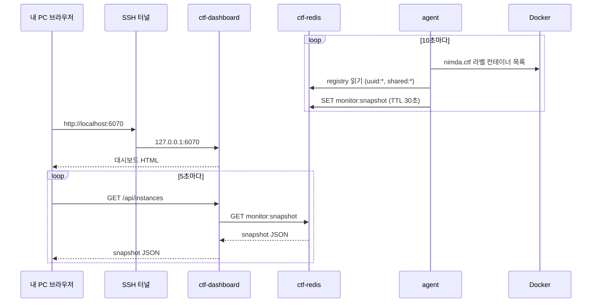

# [Feature-01] 인스턴스 모니터링

* **최초 작성일:** 2026-10-23
* **최종 수정일:** 2026-10-23
* **작성자:** 이도현
* **상태:** 구현 완료 (로컬 검증, 커밋 전)

---

## 1. 개요 (Overview)

PER_USER와 SHARED 인스턴스가 둘 다 동작하게 됐다.
그런데 지금 어떤 컨테이너가 떠 있고, SHARED에 누가 들어와 있는지 보려면 `docker ps`와 `redis-cli`를 직접 쳐야 한다.
그래서 브라우저로 한눈에 볼 수 있는 대시보드를 만든다.

대시보드는 웹사이트가 아니라 CTF 서버 쪽에 둔다.
컨테이너 정보가 웹으로 넘어가지 않게 하기 위해서다.

추후 해당 관한을 가진 사용자만 확인할 수 있게 해야 한다.
이번에는 서버에 SSH로 접속할 수 있는 사람만 볼 수 있게 두고, 별도 권한 기능은 만들지 않는다.

## 2. 사용자 요구사항 (Requirements)

1. 지금 떠 있는 인스턴스를 SHARED와 PER_USER로 나눠서 볼 수 있어야 한다.
2. SHARED는 문제마다 컨테이너 상태, 포트, lease 목록과 각자의 만료 시각을 볼 수 있어야 한다.
3. PER_USER는 uuid마다 컨테이너 상태, 포트, 문제 코드를 볼 수 있어야 한다.
4. registry에 기록이 없는데 떠 있는 컨테이너(orphan)도 보여야 한다.
5. 화면은 5초마다 갱신된다.
6. agent가 죽어서 정보가 오래됐으면 화면에서 알 수 있어야 한다.
7. 인터넷에서는 대시보드에 닿을 수 없어야 한다.

이번에 하지 않는 것

- 사용자 닉네임 표시 (CTF 서버는 uuid만 안다. 아래 4번 참고)
- 화면에서 컨테이너를 내리거나 재시작하는 조작 (조회만 한다)
- CPU, 메모리 같은 리소스 사용량
- 대시보드 자체 로그인 기능

## 3. 시스템 흐름도 (Data Flow)



## 4. 설계

### 왜 웹이 아니라 CTF 서버에 둘까?

처음에는 웹 백엔드가 CTF에서 정보를 받아서 사용자 닉네임을 붙여 보여주려고 했다.
그런데 이렇게 하면 웹이 뚫렸을 때 컨테이너 ID, 호스트 포트, orphan 목록까지 CTF 인프라 전체가 같이 넘어간다.
웹 → CTF 방향으로 "주소를 내주는 API"도 새로 생긴다.

웹은 지금도 자기 uuid의 host:port는 알고 있다(프록시에 필요해서).
하지만 전체 목록까지 줄 이유는 없다.
그래서 대시보드는 CTF 서버 안에서만 보이게 한다.

### 데이터는 누가 만들까?

필요한 정보는 두 군데 나뉘어 있다.

- **registry (ctf-redis):** 어느 uuid가 어느 컨테이너인지, SHARED lease 목록
- **Docker:** 컨테이너가 실제로 떠 있는지, 포트가 몇 번인지

Docker를 만질 수 있는 건 agent뿐이다(ADR-0009).
그런데 agent는 특권 프로세스라 HTTP listener를 열지 않기로 했다.
뚫리면 호스트 root와 같은 권한이 넘어가기 때문이다.

그래서 agent가 **10초마다 snapshot을 만들어 ctf-redis에 쓴다.**
대시보드는 snapshot을 읽어서 보여주기만 한다.
agent는 지금처럼 Redis만 바라보고, 새로 열리는 포트가 없다.

**대시보드가 registry를 직접 읽으면 안 될까?**

registry만 읽으면 "기록상 있는 것"만 보인다.
컨테이너가 죽었는지, orphan이 있는지는 Docker를 봐야 알 수 있다.
모니터링에서 제일 알고 싶은 게 그 부분이라 agent가 만들어야 한다.

### snapshot은 TTL 30초로 둔다

agent가 죽으면 snapshot이 더 이상 갱신되지 않는다.
TTL을 30초로 걸어두면 agent가 죽고 30초 뒤에 키가 사라진다.
대시보드는 키가 없으면 503을 돌려주고, 화면에는 "agent 응답 없음"이 뜬다.
`generatedAt`도 같이 내려주니까 화면에서 몇 초 전 정보인지 보여줄 수 있다.

### 대시보드는 provisioner와 따로 띄운다

provisioner에 대시보드를 넣으면 컨테이너가 하나 덜 생기니까 간단해 보인다.
하지만 provisioner는 웹과 통신하려고 `nimda-network`에도 붙어 있다.
그러면 웹 백엔드 컨테이너에서 `ctf-provisioner:6070`으로 대시보드에 닿는다.
웹이 뚫리면 대시보드도 같이 보이는 셈이다.

그래서 대시보드는 `ctf-dashboard` 컨테이너로 따로 띄우고 `ctf-internal`에만 붙인다.
하는 일은 ctf-redis에서 snapshot 하나를 읽는 것뿐이라 권한도 필요 없다.

### 접근은 SSH 터널로 한다

대시보드는 호스트의 `127.0.0.1:6070`에만 연다.
인터넷에서 `서버주소:6070`으로 들어오면 연결 자체가 안 된다.

볼 때는 내 PC에서 SSH 터널을 연다.

```
ssh -L 6070:127.0.0.1:6070 사용자@서버주소
```

"내 PC의 6070번으로 오는 요청을 SSH를 통해 서버의 127.0.0.1:6070으로 보내라"는 뜻이다.
터널을 연 채로 내 PC 브라우저에서 `http://localhost:6070`을 열면 대시보드가 그대로 뜬다.
터미널은 터널을 유지하는 역할만 하고, 화면은 브라우저로 본다.
VS Code Remote-SSH를 쓰면 "Ports" 탭에서 6070을 추가하는 것만으로 같은 터널이 열린다.

**그럼 로그인 기능은 필요 없을까?**

대시보드에 닿을 수 있는 사람은 SSH 키를 가진 사람뿐이다.
"권한을 가진 사람만 본다"가 SSH 접속 권한으로 정해지는 셈이다.

CTF 서버에서 웹의 로그인을 그대로 쓰려면 JWT 키를 넘겨받아야 하는데, 그건 ADR-0016에서 이미 기각했다.
HS256은 검증 키가 곧 발급 키라서, 키를 넘기면 토큰을 찍어낼 권한까지 넘어가기 때문이다.

로컬 개발 환경에서는 터널 없이 `http://localhost:6070`으로 바로 열린다.

### 사용자는 uuid로만 보인다

CTF 서버는 사용자를 모른다(ADR-0018).
uuid → 사용자 매핑은 웹의 nimda-redis(`ctf:request:owner:{uuid}`)에만 있다.
그래서 대시보드에는 uuid까지만 나온다.

누가 요청했는지 알아야 하면 웹 쪽에서 uuid로 따로 찾는다.
매핑을 CTF로 가져오면 결국 사용자 정보가 CTF로 넘어오는 거라 하지 않는다.

## 5. API

대시보드 컨테이너가 제공하는 API는 두 개다.
둘 다 `127.0.0.1:6070`에서만 열린다.

### 5-1. 대시보드 화면

```
GET /
```

HTML 한 장을 내려준다.
Go `embed`로 바이너리에 넣는다. 별도 프론트 빌드는 없다.

### 5-2. 인스턴스 목록

```
GET /api/instances
```

**응답 200**

```json
{
  "generatedAt": "2026-10-23T05:10:00Z",
  "summary": {
    "containers": 4,
    "running": 3,
    "shared": 1,
    "perUser": 2,
    "leases": 3,
    "orphans": 1
  },
  "shared": [
    {
      "challengeCode": "web-basic-01",
      "instanceId": "8ea72b98f32a",
      "containerName": "ctf-web-basic-01",
      "state": "RUNNING",
      "hostPort": 53974,
      "createdAt": "2026-10-23T04:50:12Z",
      "idleSince": null,
      "leases": [
        {
          "uuid": "dee65663-35a2-4f01-858b-cd33bdc0032c",
          "expiresAt": "2026-10-23T05:50:12Z",
          "expired": false
        }
      ]
    }
  ],
  "perUser": [
    {
      "uuid": "666e6ada-ea88-4444-b710-c56145b37773",
      "challengeCode": "web-basic-01",
      "instanceId": "2981057bc00b",
      "containerName": "ctf-web-basic-01-666e6ada-ea88-4444-b710-c56145b37773",
      "state": "RUNNING",
      "hostPort": 57645,
      "createdAt": "2026-10-23T05:01:40Z"
    }
  ],
  "orphans": [
    {
      "instanceId": "f591cb04d1a8",
      "containerName": "ctf-web-basic-01",
      "challengeCode": "web-basic-01",
      "uuid": "fc85320a-0fa6-4444-8615-c93bae0e3c25",
      "state": "EXITED",
      "createdAt": "2026-10-23T03:20:00Z"
    }
  ]
}
```

**응답 503** (snapshot이 없음 = agent가 30초 넘게 갱신하지 않음)

```json
{ "error": "agent 상태 정보를 받을 수 없습니다" }
```

**응답 502** (ctf-redis에 연결할 수 없음)

```json
{ "error": "ctf-redis에 연결할 수 없습니다" }
```

### 5-3. 필드 설명

| 필드 | 설명 |
| --- | --- |
| `generatedAt` | agent가 snapshot을 만든 시각. 화면은 "N초 전"으로 보여준다 |
| `state` | `RUNNING`, `EXITED`(멈춤), `MISSING`(registry에는 있는데 컨테이너가 없음) |
| `hostPort` | 호스트에 열린 포트. 멈췄거나 없으면 null |
| `instanceId` | 컨테이너 ID 앞 12자리 (`docker ps`와 같은 길이) |
| `idleSince` | SHARED lease가 0개가 된 시각. 사용 중이면 null (reaper가 생기면 채워진다) |
| `leases[].expired` | 만료 시각이 지났는데 아직 reaper가 안 지운 lease면 true |
| `orphans` | `nimda.ctf` 라벨은 있는데 registry에 기록이 없는 컨테이너 |

PER_USER에는 `expiresAt`이 없다.
registry가 PER_USER 만료 시각을 아직 저장하지 않기 때문이다(ADR-0014 작업에서 추가).

### 5-4. agent → ctf-redis (snapshot)

```
SET monitor:snapshot <JSON> EX 30
```

- 값은 5-2의 응답 본문과 같다. 대시보드는 읽어서 그대로 내려준다.
- 타입은 `protocol` 모듈에 둔다(`protocol.MonitorSnapshot`). agent가 쓰고 대시보드가 읽는 계약이기 때문이다.
- 10초마다 덮어쓴다.
- 만드는 방법
  1. Docker에서 `nimda.ctf` 라벨이 붙은 컨테이너를 전부 가져온다 (멈춘 것 포함).
  2. registry의 `shared:*`와 `uuid:*`를 SCAN으로 읽는다.
  3. registry 기록과 컨테이너를 instanceId로 맞춘다. 짝이 없는 컨테이너는 orphan이다.

## 6. 화면

- **상단:** summary 카드 (컨테이너, running, SHARED, PER_USER, lease, orphan 수)와 "N초 전 갱신"
- **SHARED 표:** 문제 코드, 상태, 포트, 참가자 수, 생성 시각. 행을 펼치면 lease 목록 (uuid, 만료 시각, 만료 여부)
- **PER_USER 표:** uuid, 문제 코드, 상태, 포트, 생성 시각
- **orphan 표:** 있을 때만 보인다
- agent 응답이 없으면(503) 상단에 경고를 띄우고 마지막으로 받은 데이터를 흐리게 보여준다.

## 7. 작업 순서 (모듈 단위)

1. **protocol:** `MonitorSnapshot` 타입 정의
2. **agent:** snapshot을 만드는 goroutine (10초 주기, Docker 라벨 조회, registry SCAN)
3. **dashboard:** 새 모듈. `GET /api/instances`와 HTML 화면
4. **compose:** `ctf-dashboard` 서비스 추가. `ctf-internal`에만 붙이고 `127.0.0.1:6070`으로만 publish

1번이 계약이라 먼저 확정한다.
2번과 3번은 1번만 있으면 따로 해도 된다.

## 8. 정해야 할 것

- **dashboard를 새 모듈로 둘지:** `dashboard/`를 새 Go 모듈로 만들고 `go.work`에 추가하는 걸 추천한다.
  provisioner 모듈 안에 `cmd/dashboard`로 두는 방법도 있지만, 역할이 다른 바이너리가 한 모듈에 섞인다.
- **갱신 주기:** agent 10초, 화면 5초. 동아리 규모(동시 10~20개)라 부담은 없다.
- **포트:** 6070. 다른 서비스와 겹치지 않는지 확인이 필요하다.
